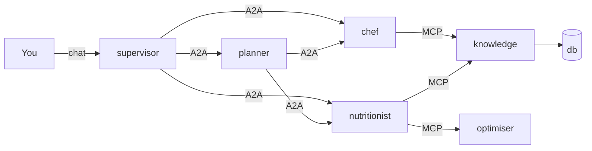

# Architecture

A bulk-cooking meal planner that runs on a local model. You chat with a supervisor, which hands cooking questions to a chef, nutrition questions to a nutritionist, and "plan my week" to a planner.

## Services

| Service | Job |
|---|---|
| `supervisor` | Agent you talk to. Routes each request |
| `chef` | Agent. Cooking questions, recipes and steps, from the cookbooks |
| `nutritionist` | Agent. Nutrition questions, and scaling a week to its targets |
| `planner` | Workflow, not an agent. Plans a week by giving jobs to the chef and nutritionist |
| `knowledge` | Search tools over the cookbook stores |
| `optimiser` | The solver and the nutrition lookup |
| `db` | PostgreSQL with pgvector |

Agents talk to each other over A2A and to their tools over MCP.
