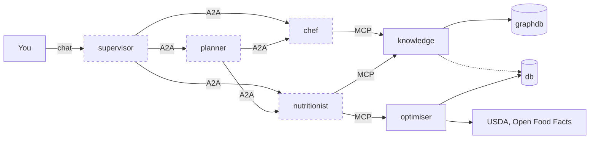

# Architecture

A bulk-cooking meal planner that runs on a local model. You chat with a supervisor, which hands cooking questions to a chef, nutrition questions to a nutritionist, and "plan my week" to a planner.

It's built tools first. The two tool servers and their databases exist. The planner and the agents come last.

## Services

Dashed boxes and lines aren't built yet.

| Service | Job | Built |
|---|---|---|
| `supervisor` | Agent you talk to. Routes each request | No |
| `chef` | Agent. Cooking questions, recipes and steps, from the cookbooks | No |
| `nutritionist` | Agent. Nutrition questions, and scaling a week to its targets | No |
| `planner` | Workflow, not an agent. Plans a week by giving jobs to the chef and nutritionist | No |
| `knowledge` | MCP server. Flavour pairings today, recipe search later | Yes |
| `optimiser` | MCP server. The solver and the nutrition lookup | Yes |
| `graphdb` | Neo4j. The pairing graph | Yes |
| `db` | PostgreSQL with pgvector. Nutrition data today, recipe search later | Yes |
| `llm` | gpt-oss-20b on llama.cpp, for the agents | Yes |

Agents talk to each other over A2A and to their tools over MCP.

Each service's own design is in its `docs/` folder: [knowledge](knowledge/docs/architecture.md) and [optimiser](optimiser/docs/architecture.md).
