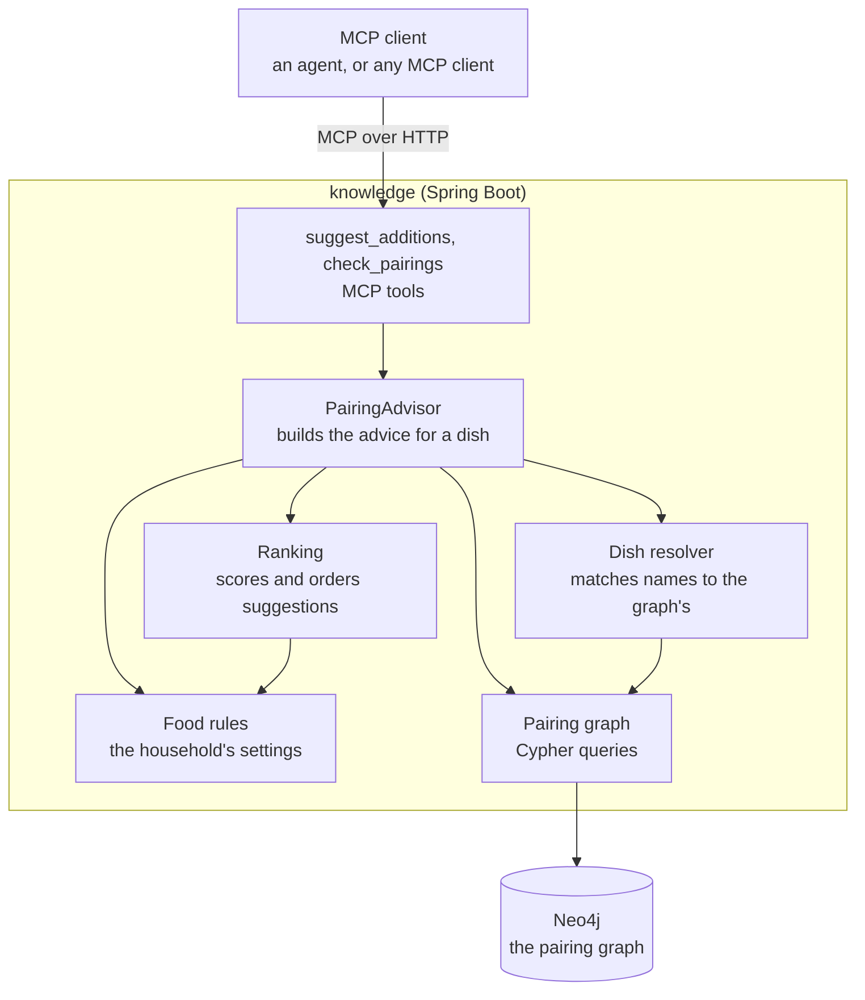

# knowledge

An MCP server that answers "what goes with this dish?" from a graph of flavour pairings. Recipe search over the cookbooks comes later.

Flows:
- [Suggesting additions](flows/suggest-additions.md)
- [Checking pairings](flows/check-pairings.md)

Data: [the pairing graph](data-model.md)

## Components

What this service is made of. How it connects to the other services is in the root [ARCHITECTURE.md](../../ARCHITECTURE.md).

| Component | Job |
|---|---|
| MCP tools | Read the request, call the advisor, and answer as text and as structured content |
| `PairingAdvisor` | Resolves the dish, asks the graph what pairs with it, and puts the advice together |
| Dish resolver | Turns the names someone asked about into the names the graph uses |
| Ranking | Scores each candidate, drops what the rules forbid, and orders the rest |
| Food rules | What a household never wants suggested, what to go easy on, and the basics not worth suggesting |
| Pairing graph | Reports what the graph holds. It applies no rules and ranks nothing |

The pairing graph sits behind an interface, so the advisor, the resolver and the ranking don't know it's Neo4j.

## How names are matched

A dish arrives as plain names, and the graph has its own. The resolver tries, in order:

- The name as given, and its singular and plural: `lemon` finds `lemons`.
- The words inside it: `salmon fillets` isn't in the graph, but `salmon` is.
- Failing both, it reports the name as unknown, with close names from the graph to try.

An ingredient with no entry of its own borrows its parent's. Chicken thighs have none, so they use the pairings for chicken.

## How suggestions are ranked

Every pairing in the graph has a strength from 1 to 4. A candidate's score is the sum of the strengths of every pairing that names it, so something that goes with three of the dish's ingredients beats something that goes strongly with one.

The household's rules then apply:

| Rule | Effect |
|---|---|
| Never | The candidate is left out, and listed separately so the caller knows it was held back |
| Go easy on | The candidate stays, with points taken off its score |
| Basics | Salt, oil, water and the like are left out. They pair with everything and say nothing |

The rules are settings, not data. The graph holds its source as it is, and a rule matches whole words: `ham` forbids smoked ham, not champagne.
