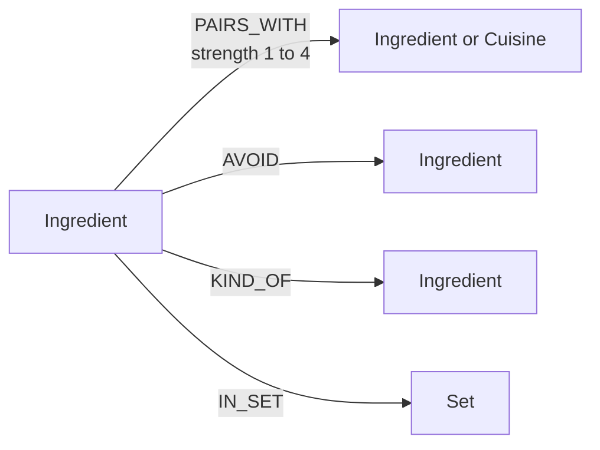

# knowledge data

One Neo4j database, holding a graph of flavour pairings.

## Nodes

| Node | What it is | Properties |
|---|---|---|
| `Ingredient` | A food, by the name it's listed under | `name` (unique), `is_entry`, and notes on it: `season`, `taste`, `weight`, `volume`, `techniques`, `function`, `tips`, `see` |
| `Cuisine` | An entry that is a cuisine, not a food | The same as `Ingredient` |
| `Set` | A combination of ingredients known to work together | `id` (unique), `listed_under`, `size`, `source` |

`is_entry` says whether the ingredient has an entry of its own, with its own list of pairings. One that doesn't is only ever named in other entries.

## Relationships

| Relationship | Means | Properties |
|---|---|---|
| `PAIRS_WITH` | One ingredient's entry lists another | `strength` from 1 to 4, `note`, `source` |
| `AVOID` | Two ingredients that are said not to go together | `source` |
| `KIND_OF` | An ingredient is a kind of another, such as cherry tomatoes and tomatoes | |
| `IN_SET` | An ingredient is a member of a set | |

`PAIRS_WITH` has a direction: it runs from the entry to what the entry lists. The reverse isn't always there, so queries look both ways.

## Where the data comes from

The full graph is built from a book I own, so that data isn't in the repo. `samples/pairings/` has a small hand-written set in the same shape: six CSV files, and `load.cypher` to load them.

`load.cypher` rebuilds the graph from the CSV files in `volumes/graphdb/import/`. It deletes what's there first.

The graph holds its source as it is. What a household never wants suggested is a setting applied when the graph is queried, not something written into the data.
