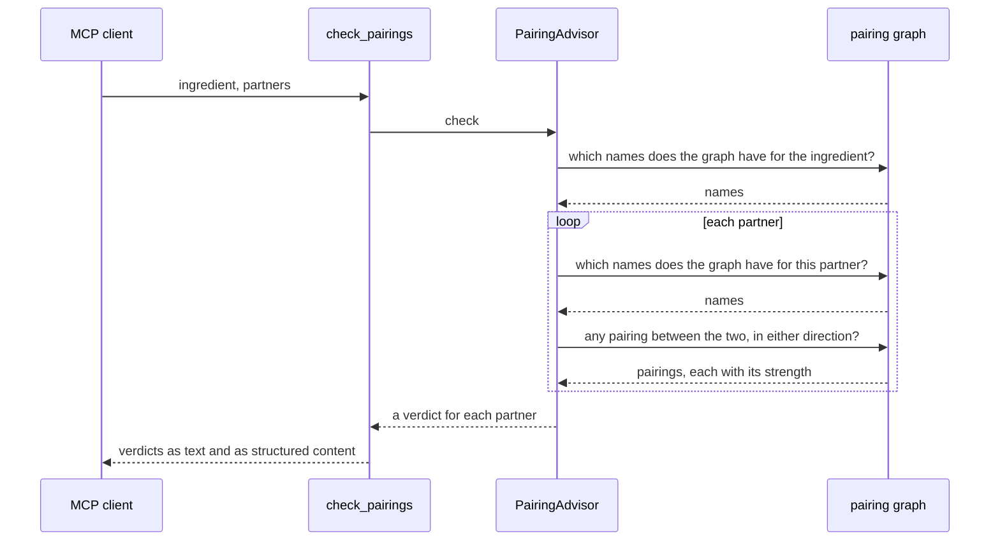

# Checking pairings

What happens when a client calls `check_pairings` to confirm that one ingredient goes with each of several others. It's the short tool: use it to check a pairing before citing it, and `suggest_additions` to find new ideas.

## What a verdict says

| For each partner | Meaning |
|---|---|
| Known | Whether the graph has a name for it |
| Paired | Whether any pairing links it to the ingredient |
| Pairings | The pairings that say so, with their strength from 1 to 4 |

A pairing counts in either direction. One ingredient's entry may list the other without the reverse being true.

The household's rules don't apply here. This tool reports what the graph holds.
