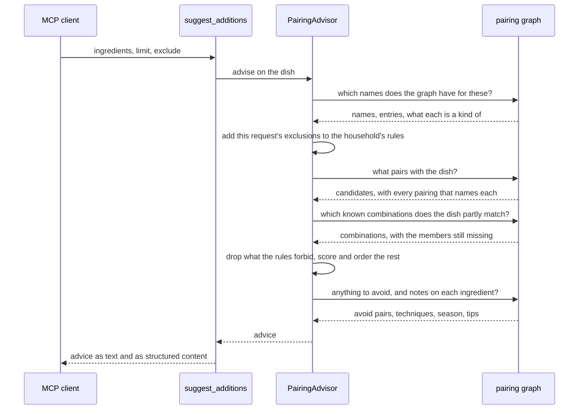

# Suggesting additions

What happens when a client calls `suggest_additions` with a dish's main ingredients.

## What comes back

| Part | What it is |
|---|---|
| The dish | The names that were matched, and any that weren't |
| Combinations | Known combinations the dish already has part of, with what's missing from each |
| Suggestions | The top single additions, each with its score and the pairings behind it |
| Held back | Candidates the rules forbid, by name |
| Avoid | Pairs involving the dish that are said not to work |
| Notes | Techniques, season and tips for each ingredient |

A dish with one ingredient matches any combination that contains it. With two or more, a combination has to contain at least two of them.

## When it stops early

| Why | The answer says |
|---|---|
| None of the names are in the graph | Which names weren't found, with close names to try. No suggestions |
| The graph can't be reached | That there are no pairings to offer right now |
| The call leaves out the ingredients | Which field is missing. The server checks each call against the tool's schema |
| The limit is below 1 | That the limit must be at least 1 |
