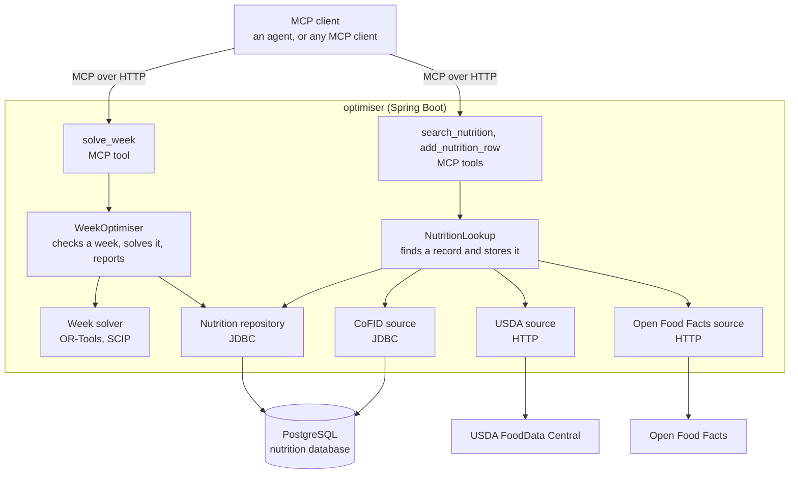

# optimiser

An MCP server with two jobs: scaling a week's recipes to its targets, and looking up nutrition values.

Flows:
- [Solving a week](flows/solve-week.md)
- [Looking up nutrition](flows/nutrition-lookup.md)

Data: [the nutrition database](data-model.md)

## Components

What this service is made of. How it connects to the other services is in the root [ARCHITECTURE.md](../../ARCHITECTURE.md).

| Component | Job |
|---|---|
| MCP tools | Read the request, call the use case, and answer as text and as structured content |
| `WeekOptimiser` | Checks the targets and the week, has the week solved, and builds the report |
| `NutritionLookup` | Searches a source, and stores a record as an ingredient's rows |
| Week solver | Builds the mixed-integer programme and solves it |
| Nutrition repository | Reads the nutrition table, and adds rows without changing any that are there |
| CoFID, USDA and Open Food Facts sources | Search one reference source each, and turn its figures into a food label's |

The solver, the repository and the sources each sit behind an interface, so `WeekOptimiser` and `NutritionLookup` don't know which library or database is on the other side.

## How a week is solved

`solve_week` takes the week and the targets in the request, and reads only the nutrition table from the database. It builds a mixed-integer programme with Google's OR-Tools and solves it with the SCIP solver:

- Each ingredient moves in whole steps: 10g of meat, one egg, a quarter teaspoon of spice.
- Each recipe's other ingredients follow its main ingredient, within their bands.
- Each day is held to its calories, protein, fat and carbs, a salt limit, a fibre minimum and five a day.

It returns every amount, each day's totals, the shopping totals and a list of checks.
