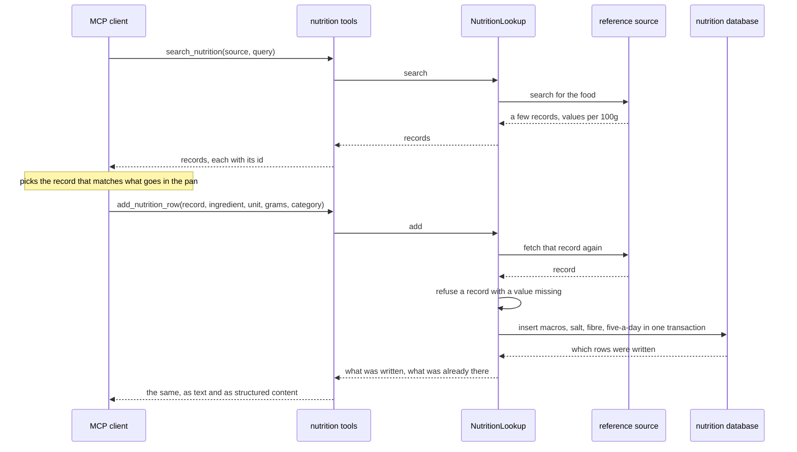

# Looking up nutrition

An ingredient gets into the nutrition table in two calls: `search_nutrition` to find a record, then `add_nutrition_row` to store it.

## The three sources

| Source | Where it's read from | Used for |
|---|---|---|
| `cofid` | A table in the nutrition database | First choice. The UK's reference foods |
| `usda` | USDA FoodData Central, over HTTP | Whole foods that are the same anywhere, when CoFID has no good match |
| `off` | Open Food Facts, over HTTP | Packaged foods the other two don't have |

Each source measures things its own way, so each is converted to the figures a European food label gives: carbohydrate by its own weight with fibre apart, and salt in place of sodium.

The two HTTP sources are asked again, up to three times, when they answer that they're busy. Open Food Facts has a second search service that's used when the main one is down.

## Why the record is fetched twice

`add_nutrition_row` takes a record's id, not its values. The values are read from the source again at the moment they're stored, so what goes into the table is the source's figures and not a copy that passed through the caller.

## Adding never changes a row

Each insert leaves a row alone if it's already there. Adding the same ingredient twice changes nothing, and adding an ingredient that only lacks fibre fills in the fibre and nothing else. The answer says which rows were written and which were left.
