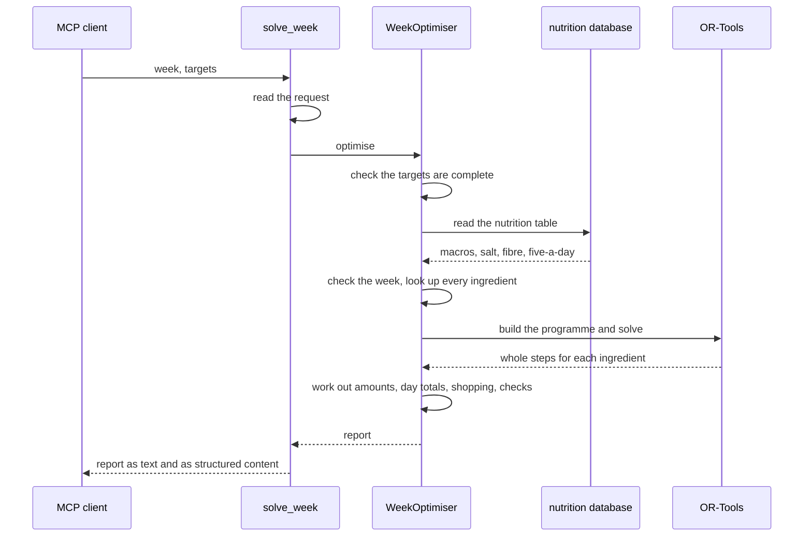

# Solving a week

What happens when a client calls `solve_week`.

## When it stops early

Each of these comes back as the tool's answer, marked as an error, with what to change:

| Where | Why | The answer says |
|---|---|---|
| Reading the request | A value has the wrong shape, such as 4.7 portions | Which value, by its path in the request |
| Checking the targets | Something the solve relies on is missing | Every gap, not only the first |
| Checking the week | An unknown recipe, a meal with nothing in it, an ingredient that isn't in the table | Every problem found |
| Reading the table | The database can't be reached | That the nutrition tables can't be reached |
| Solving | No amounts can meet every bound | To change the plan, with suggestions |

A week that solves but misses a target is not an error. The report comes back with the failed checks listed.
